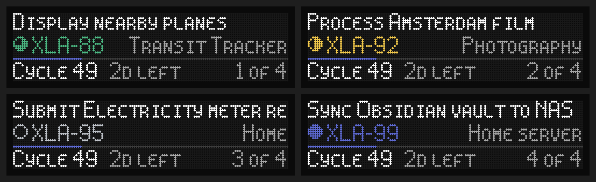

# esphome-linear-cycle

An ESPHome component that shows the issues in a [Linear](https://linear.app) cycle on a 128×32 LED dot matrix display.



## Usage

```yaml
external_components:
  - source: github://alexgokhale/esphome-linear-cycle
    components:
      - linear_cycle

font:
  - file: https://raw.githubusercontent.com/alexgokhale/esphome-linear-cycle/main/fonts/spleen/spleen-5x8.bdf
    id: spleen

display:
  - platform: hub75
    # ...
    pages:
      - id: linear_page
        lambda: |-
          id(linear).draw();

linear_cycle:
  id: linear
  api_key: !secret linear_api_key
  font_id: pixolletta
  small_font_id: spleen
  time_id: sntp_time
```

| Setting                | Default |                                                               |
|------------------------|---------|---------------------------------------------------------------|
| `api_key`              | -       | A Linear personal API key                                     |
| `team_key`             | -       | Only show this team's cycle                                   |
| `font_id`              | -       | The main font                                                 |
| `small_font_id`        | -       | Font for lowercase letters in small caps                      |
| `time_id`              | -       | Clock for the time left in the cycle                          |
| `scroll_speed`         | `10`    | Pixels per second                                             |
| `pause_before_scroll`  | `5s`    | How long an issue sits still before scrolling                 |
| `pause_before_reverse` | `1s`    | How long it waits once scrolled to the end                    |
| `pause_before_next`    | `2s`    | How long it waits after scrolling back, before the next issue |
| `update_interval`      | `60s`   | How often to ask Linear                                       |

If Linear can't be reached, the previously fetched data stays on the screen.
